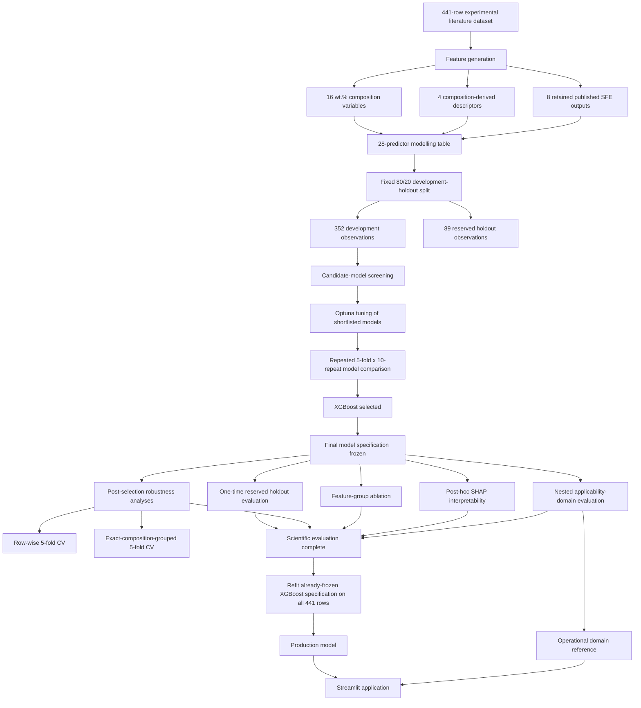

# Final Computational Pipeline

This document describes the final computational workflow used for stacking-fault-energy prediction in multicomponent steels.

The purpose of the pipeline is to keep data preparation, model development, final evaluation, interpretation, applicability assessment, and deployment logically separated. In particular, the final model specification is selected and frozen before the reserved holdout is evaluated.

## Pipeline overview



## 1. Experimental dataset

The final dataset contains 441 observations with experimentally reported SFE values.

Key properties are:

- 441 experimental observations;
- 354 unique exact nominal compositions;
- 16 elemental composition variables in wt.%;
- all final compositions close to 100 wt.% within floating-point tolerance;
- Fe treated as the balance element during data preparation;
- 47 repeated-composition groups involving 134 observations;
- experimental SFE target range approximately 3.26–131 mJ/m²;
- nominal temperature fixed at 300 K in the final modelling table.

Rows based on modelled or thermodynamic target values are not part of the final target dataset.

## 2. Feature generation

The final modelling representation contains 28 predictors.

### Composition variables

Sixteen elemental composition variables are retained directly in wt.%:

- Fe
- Mn
- Al
- C
- Ni
- Cr
- Si
- Cu
- Mo
- Nb
- V
- Ti
- Co
- N
- P
- S

### Composition-derived descriptors

Wt.% values are converted to atomic fractions using:

```text
n_i = w_i / A_i
x_i = n_i / Σ n_i
```

The four descriptors are:

```text
R_mean = Σ x_i R_i

R_std = sqrt[Σ x_i (R_i - R_mean)²]

Δχ = sqrt[Σ x_i (χ_i - χ_mean)²]

VEC_mean = Σ x_i VEC_i
```

### Published SFE-model outputs

Eight retained published SFE-model outputs are used as engineered predictors:

- Akbari
- Allain
- Dumay
- Elaraby
- Wang
- Xiong
- Yoo
- Zambrano

For numerical evaluation of the published SFE formulations, exact-zero elemental inputs used within an SFE equation are internally replaced by a trace value of `0.0001 wt.%` (1 ppm) where required to avoid undefined logarithmic or reciprocal operations. This numerical safeguard is applied only inside the SFE-formula calculations; the original composition variables and the composition-derived descriptors remain unchanged.

For the retained SFE-model outputs, values satisfying:

```text
|SFE_model_output| > 1e6
```

are converted to missing values. Median imputation is then fitted inside the relevant training partition through the model pipeline.

## 3. Fixed development/holdout split

A single fixed 80/20 split is created using random seed 42 with target-stratified binning.

The resulting partitions are:

```text
Development: 352 observations
Holdout:      89 observations
```

The split is saved as `development_split_manifest.csv` and reused throughout model development and final evaluation.

The reserved holdout is not used for:

- candidate-model screening;
- hyperparameter tuning;
- repeated-CV final model selection;
- feature-group ablation.

## 4. Candidate-model screening

Candidate model families are evaluated using 5-fold shuffled row-wise cross-validation within the 352-row development partition.

The ranking rule is:

1. lowest mean RMSE;
2. MAE as the secondary metric;
3. R² as supporting information.

The final tuning shortlist contains:

- XGBoost;
- Gradient Boosting;
- Extra Trees;
- HistGradientBoosting.

## 5. Hyperparameter tuning

Each shortlisted family is evaluated with 100 Optuna trials using only the development partition.

The tuning objective is mean 5-fold development-CV RMSE.

No reserved-holdout metric is calculated during tuning.

## 6. Repeated-CV final model selection

Frozen candidate configurations are compared using matched repeated cross-validation:

```text
5 folds x 10 repeats = 50 validation folds
```

The final mean repeated-CV results are:

| Rank | Model | RMSE | MAE | R² |
|---|---|---:|---:|---:|
| 1 | XGBoost | 10.980 | 6.531 | 0.556 |
| 2 | Gradient Boosting | 11.153 | 6.821 | 0.547 |
| 3 | Extra Trees | 11.192 | 7.059 | 0.547 |
| 4 | HistGradientBoosting | 11.428 | 7.144 | 0.518 |

XGBoost is selected according to the pre-specified ranking criterion.

## 7. Model freeze point

The final model specification is frozen immediately after repeated-CV model selection.

The frozen specification includes:

- model family: XGBoost;
- complete 28-feature representation;
- preprocessing and median-imputation logic;
- hyperparameters;
- random-state configuration.

No later analysis is allowed to alter the selected model family, feature set, or hyperparameters.

The frozen XGBoost hyperparameters are:

```text
objective          = reg:squarederror
n_estimators       = 500
learning_rate      = 0.011411002001291685
max_depth          = 8
min_child_weight   = 2.665840052140506
subsample          = 0.78310286906201
colsample_bytree   = 0.837235999618537
gamma              = 0.8987126718179128
reg_alpha          = 6.425544478395007e-08
reg_lambda         = 0.029156850643502742
random_state       = 42
n_jobs             = 1
tree_method        = hist
verbosity          = 0
```

## 8. Reserved-holdout evaluation

After the model specification is frozen, the model is fitted on the 352-row development partition and evaluated once on the 89-row holdout.

Final holdout performance:

| Metric | Result |
|---|---:|
| R² | 0.706 |
| RMSE | 8.17 mJ/m² |
| MAE | 4.81 mJ/m² |
| MAPE | 22.35% |
| Pearson r | 0.841 |

No model changes are made in response to the holdout result.

## 9. Post-selection robustness evaluation

Two additional full-dataset analyses are performed after model selection.

### Row-wise 5-fold cross-validation

| Metric | Result |
|---|---:|
| R² | 0.618 |
| RMSE | 10.27 mJ/m² |
| MAE | 5.83 mJ/m² |
| Pearson r | 0.786 |

### Exact-composition-grouped 5-fold cross-validation

Identical nominal compositions are constrained to remain within the same fold.

Exact groups are defined using the numeric tuple of all 16 composition variables, with no rounding or near-duplicate clustering.

| Metric | Result |
|---|---:|
| R² | 0.491 |
| RMSE | 11.86 mJ/m² |
| MAE | 6.73 mJ/m² |
| Pearson r | 0.714 |

This grouped result is a stricter internal sensitivity analysis for compositionally less familiar observations. It is not independent external validation.

## 10. Controlled feature-group ablation

The frozen XGBoost configuration is compared across four feature representations using the same repeated-CV protocol.

| Feature set | Predictors | RMSE | MAE | R² |
|---|---:|---:|---:|---:|
| Composition only | 16 | 11.262 | 6.604 | 0.532 |
| Composition + descriptors | 20 | 11.162 | 6.531 | 0.541 |
| Composition + SFE outputs | 24 | 11.004 | 6.575 | 0.554 |
| Full feature set | 28 | 10.980 | 6.531 | 0.556 |

The model is not independently retuned for each ablation condition.

The full representation reduces RMSE by approximately 2.5% relative to composition alone.

## 11. SHAP interpretability

The frozen XGBoost model is fitted on the original development partition and explained on the reserved holdout using Tree SHAP.

Feature-family mean absolute SHAP attribution is:

| Feature family | Share |
|---|---:|
| Composition | 66.91% |
| Published SFE-model outputs | 20.47% |
| Composition-derived descriptors | 12.62% |

SHAP is post-hoc interpretation only. It is not used for feature selection, retuning, or model redesign.

SHAP values describe fitted-model behaviour and are not treated as proof of metallurgical causality.

## 12. Nested applicability-domain analysis

The applicability-domain procedure combines:

- visible composition ranges;
- a PCA-assisted kNN dense-composition criterion.

Domain construction is evaluated with nested exact-composition-grouped cross-validation. For each outer fold, all domain-selection decisions are based only on the outer-training partition before the frozen rule is applied to the untouched outer-validation partition.

Final pooled nested results are:

| Metric | Result |
|---|---:|
| Coverage | 47.4% |
| Inside-domain reliability at APE ≤20% | 77.5% |
| Outside-domain reliability | 53.0% |
| Inside-domain RMSE | 6.94 mJ/m² |
| Outside-domain RMSE | 13.20 mJ/m² |
| Inside-domain MAE | 4.26 mJ/m² |
| Outside-domain MAE | 8.22 mJ/m² |
| Inside-domain R² | 0.704 |

The applicability-domain procedure is therefore evaluated out of sample within the compiled dataset, but it remains internal validation rather than validation on an independent external dataset.

## 13. Production refit

After scientific model selection and evaluation are complete, the already-frozen XGBoost specification is refitted using all 441 observations.

This full-data refit is used only for deployment.

It does not represent:

- a new model-selection step;
- new hyperparameter tuning;
- a replacement for the reserved-holdout result.

The production refit exists so that the deployed application can use all available training information after the model specification has already been fixed.

## 14. Streamlit deployment

The final Streamlit application:

- accepts alloy composition in wt.%;
- treats blank Fe as balance Fe;
- calculates the four descriptors;
- calculates the eight retained SFE outputs;
- constructs the 28-feature model input;
- predicts SFE using the full-data refit of the frozen XGBoost specification;
- evaluates the operational visible-range and kNN applicability criteria;
- labels predictions as `INSIDE` or `OUTSIDE` the operational applicability domain.

Predictions outside the applicability domain are not blocked, but they are explicitly presented with greater caution.

## Validation scope

The project distinguishes three levels of evidence:

1. reserved-holdout evaluation of the frozen model;
2. internal robustness analyses, including exact-composition-grouped validation and nested applicability-domain evaluation;
3. independent external validation.

The first two are implemented in this repository. Independent external validation remains future work.
